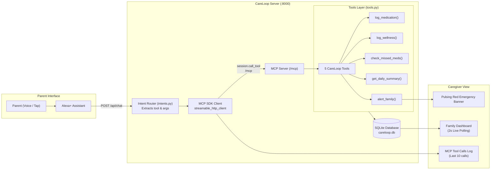

# CareLoop 🧡
### Alexa+ that looks after your parents

CareLoop is a privacy-first, zero-external-API elder care companion and monitoring platform. It connects aging parents to their daily medication routine and family caregivers through natural spoken voice (Alexa+) and a real-time family dashboard backed by the **Model Context Protocol (MCP)**.

---

## 1. The Problem

Aging in place is the preferred choice for most seniors, but it introduces major anxiety for families:
- **Medication Forgetfulness**: Complex schedules (e.g., morning blood pressure pills, afternoon vitamins, evening diabetes medications) are easily missed.
- **Silent Emergencies**: Minor falls, bouts of dizziness, or sudden chest pains often go unreported because parents don't want to "worry" their children until it's too late.
- **Intrusive Alternatives**: Video cameras feel invasive, and complicated smartphone apps are difficult for seniors with arthritis or failing eyesight.
- **Disconnected Care**: Family members often lack real-time visibility into whether daily medications were taken on time.

CareLoop solves this by providing an ambient, conversational voice interface that feels like a natural conversation with Alexa+, while autonomously dispatching urgent alerts and updating a real-time family adherence dashboard.

---

## 2. What It Does

- **Natural Speech Intake**: Parents simply speak (`"I took my BP tablet"` or `"I feel dizzy"`) or tap large, high-contrast prompt chips.
- **Intelligent Fuzzy Matching**: Translates colloquial descriptions (e.g., *"bp pill"*, *"metformin 500"*, *"vit d"*) to canonical scheduled medications without rigid phrasing.
- **Autonomous Emergency Detection**: Instantly analyzes reported symptoms. If critical triggers (*dizzy*, *fell*, *fall*, *chest pain*, *can't breathe*, *bleeding*) are detected, it dispatches an immediate high-severity alert to family members.
- **Missed Medication Detection**: Actively monitors time-of-day schedules against logged intakes to flag missed doses once scheduled windows pass.
- **Live Family Dashboard**: Family members get a real-time view of medication cards (green taken, amber due soon, red missed), mood badges, activity timeline, and pulsing emergency banners.
- **Standards-Compliant MCP Server**: Exposes 5 typed tools over **Streamable HTTP** (MCP spec 2025-11-25+), enabling native integration into LLMs and Alexa+ agents.

---

## 3. Architecture



---

## 4. MCP Tools Reference

The server exposes 5 core tools compliant with the official Model Context Protocol (MCP):

| Tool Name | Parameters | Description | Return Type |
| :--- | :--- | :--- | :--- |
| `log_medication` | `name: str`<br/>`taken_at: str \| None` | Fuzzy-matches spoken name (e.g., "bp pill") against schedule and logs intake into SQLite. | `dict` |
| `log_wellness` | `mood: str`<br/>`symptoms: str` | Records mood and symptoms. If high-risk symptoms (dizzy, fell, fall, chest pain, can't breathe, bleeding) are detected, triggers `alert_family` with severity `"high"`. | `dict` |
| `check_missed_meds` | *None* | Evaluates scheduled medicines whose time has passed today without an intake log. | `dict` |
| `get_daily_summary` | *None* | Returns aggregated summary for today: `taken`, `missed`, `mood`, and `alerts`. | `dict` |
| `alert_family` | `reason: str`<br/>`severity: str` | Dispatches an alert (`"low"`, `"medium"`, `"high"`), stores in SQLite, and logs a banner to console. | `dict` |

---

## 5. Getting Started

### Prerequisites
- Python 3.11+
- Node.js (optional, for `@modelcontextprotocol/inspector`)

### Installation

```bash
# Clone or navigate to the repository
cd careloop

# Install pinned dependencies
pip install -r requirements.txt
```

### Running the Server

Start the Starlette application and Streamable HTTP MCP server on port `8000`:

```bash
# Standard mode
python server.py

# Or Demo Mode (seeds schedule times relative to now: -1h, +2h, +5h with 0 missed medicines)
# Windows PowerShell:
$env:DEMO_MODE="1"; python server.py

# Linux / macOS / Bash:
DEMO_MODE=1 python server.py
```

Access the interfaces:
- **Web Dashboard & Simulator**: [http://localhost:8000/](http://localhost:8000/)
- **MCP Streamable HTTP Endpoint**: `http://localhost:8000/mcp`
- **Chat Endpoint**: `POST http://localhost:8000/api/chat`
- **Dashboard State JSON**: `GET http://localhost:8000/api/dashboard`
- **Reset Database**: `POST http://localhost:8000/api/reset`

---

## 6. Testing & Demonstrations

### 1. Automated Test Suite
Run the full test suite (covering MCP Streamable HTTP tool calls, fallback to `tools.py`, adherence timing, and demo mode):

```bash
python -m unittest tests/test_careloop.py
```

### 2. Conversational Demo Script
In a separate terminal, run the automated demo script:

```bash
python scripts/demo.py
```
This tests:
1. `"I took my BP tablet"` (fuzzy-matched & logged with schedule adherence)
2. `"I had my Metformin"` (logged)
3. `"I feel dizzy"` (wellness check + emergency family alert triggered)

### 3. Tool Suite Self-Test
Run the tool suite self-test:

```bash
python tools.py
```

### 4. Testing with MCP Inspector (`@modelcontextprotocol/inspector`)
You can inspect the tools using the official Model Context Protocol inspector:

```bash
npx @modelcontextprotocol/inspector
```
1. In the browser UI that opens, set **Transport Type** to **Streamable HTTP** (or HTTP).
2. Enter the MCP endpoint URL:
   ```text
   http://localhost:8000/mcp
   ```
3. Click **Connect**. You will see all 5 tools with full schemas, argument types, and descriptions ready to invoke interactively.

---

## 7. Cloudflare Tunnel (Remote Access)

To expose your local CareLoop MCP server to the internet or connect remote Alexa+ endpoints securely without port forwarding:

```bash
cloudflared tunnel --url http://localhost:8000
```

Cloudflare will output a public HTTPS forwarding address (e.g., `https://random-subdomain.trycloudflare.com`). You can then connect remote MCP clients or Alexa+ agents directly to:
```text
https://random-subdomain.trycloudflare.com/mcp
```

---

## 8. Security & Privacy Considerations

> [!WARNING]
> **Prototype Demonstration Notice**: CareLoop is a proof-of-concept and hackathon demonstration exploring the Model Context Protocol (MCP) for assisted living. It is **not** a certified medical device and is **not** HIPAA/GDPR-compliant out of the box.

- **No Real Health Data**: Do **not** store real protected health information (PHI), actual prescription records, or real patient personal data in this system. Use only generic, simulated names (e.g., "BP tablet", "Vitamin D").
- **Zero-Secret Defaults**: All configurations run out-of-the-box with safe local defaults. No `.env` file or external API keys are required to execute the system.
- **Configuring Environment Variables**:
  If you choose to enable optional integrations (such as Telegram emergency notifications), configure them using environment variables:
  ```bash
  # Copy template to .env (do NOT commit .env to version control)
  cp .env.example .env
  ```
  Supported variables:
  - `PORT`: HTTP server port (default: `8000`)
  - `HOST`: Bind address (default: `0.0.0.0`)
  - `CARELOOP_DB_PATH`: Custom SQLite database path (default: `careloop.db`)
  - `TELEGRAM_BOT_TOKEN`: Telegram bot token for emergency alerts (optional)
  - `TELEGRAM_CHAT_ID`: Telegram chat ID for alert delivery (optional)
- **Local Isolation**: All adherence records and wellness check-ins remain on your local disk in SQLite (`careloop.db`), which is strictly excluded from version control via `.gitignore`.

---

## 9. Honest Notes

- **Real End-to-End MCP Integration**: The `/mcp` endpoint is a full, spec-compliant **Streamable HTTP MCP server** (MCP spec 2025-11-25+) powered by the official Python MCP SDK (`mcp>=2.0.0` / `MCPServer`). The `/api/chat` route itself acts as a real MCP client using `mcp.client.streamable_http.streamable_http_client` and `session.call_tool()` to invoke all tools through the MCP protocol layer.
- **Role of intents.py**: `intents.py` is strictly an intent and argument parser that maps elder utterances to tool names and argument payloads. It does not call database or tool logic directly.
- **Local Alexa+ Simulator**: The web simulator on the left panel allows seniors and caregivers to test spoken-style interactions without requiring proprietary Amazon Echo hardware or paid cloud APIs.

---

## 10. License

This project is licensed under the [MIT License](LICENSE).
